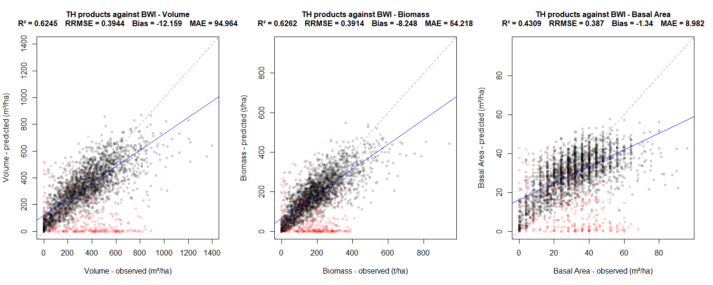
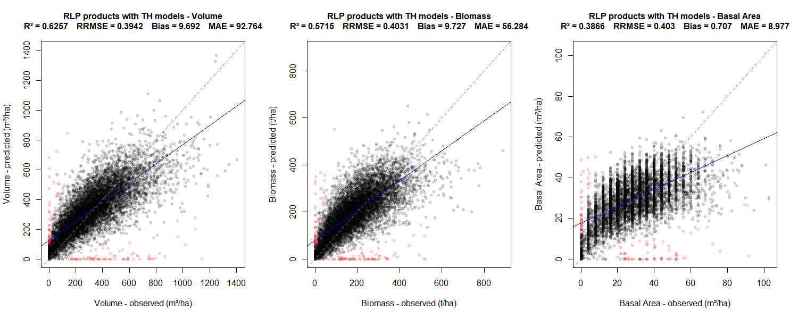

Sämtliche hier aufgeführten Layer gehört zur Gruppe der Waldstruktur-Produkte, die auf Basis von flugzeuggestütztem Laserscanning (ALS) erstellt werden. Da die Daten der deutschlandweiten ALS-Kampagne (noch) nicht vorliegen, wurden diese Produkte auf Basis der Daten der Landesvermessung erstellt, und sind bisher auf Thüringen und Rheinland-Pflaz beschränkt.

## Waldstruktur - 01 Kronenüberschirmung

Dieser Layer beschreibt den Anteil des Pixels, der von Baumkronen oder anderer Vegetation mit Höhe über 2 m überschirmt ist.

Zuerst wurde ein Bestandeshöhenmodell (canopy height model, CHM) berechnet. Dies ist ein Raster mit der Auflösung 50 cm, das den höchsten Punkt der Lidar-Punktwolke in jeder Rasterzelle ermittelt. Dabei wird eine Ausleuchtungsbreite des Laserstrahls mit einem Radius von 25 cm unterstellt. Der Bedeckungsgrad wird dann berechnet als der Anteil der 50 cm-Rasterzellen, deren Wert 2 m übersteigt.

Die Einheit ist Prozent (%).

## Waldstruktur – 02 Bestandesoberhöhe

Für jedes 10x10m Pixel wird aus den Höhen aller Punkte der Lidar-Punktwolke das 95. Perzentil berechnet. 

*Was bedeutet das?*

Dieser Höhenwert ist stark korreliert mit im Wald gemessenen Höhenmetriken wie H100. Durch die Wahl des 95. Perzentils wird verhindert, dass eventuelle Störsignale in der Punktwolke die Metrik stark beeinflussen.

Die Einheit ist Meter (m). Alle Werte sind auf ganze Meter gerundet.

## Waldstruktur - 03 Mittlere Höhe

Aus dem Bestandeshöhenmodell (CHM), das auch zur Berechnung der Kronenüberschirmung verwendet wurde, wird der Mittelwert der Höhe aller Rasterzellen im 10m-Pixel berechnet.

Dieser Wert wird auch zum Herleiten der modellierten Variablen (04-06) verwendet.

Bei geschlossenen, homogenen Beständen ist der Wert ähnlich zur Bestandesoberhöhe. Bei lückigen Beständen kann die mittlere Höhe jedoch deutlich darunter liegen.

Die Einheit ist Meter (m). Alle Werte sind auf ganze Meter gerundet.

## Waldstruktur – 04 Bestandesvorrat

Der Bestandesvorrat ist der lebende, stehende Holzvorrat an Derbolz (> 7cm) pro Hektar Holzboden. Er wird berechnet mittels des flächenbasierten Ansatzes auf 10m-Pixeln durch eine nichtlineare Regression der Form

$$V = a \cdot h ^b \cdot \rho^c$$

wobei $h$ die mittlere Höhe eines Bestandeshöhenmodells (CHM) ist, $\rho$ das abundanzgewichtete Mittel der trockenen Holzdichten der vorkommenden Baumarten, und $a$, $b$ und $c$ die Regressionskoeffizienten.

Mit Daten der Bundeswaldinventur (BWI) wurde die Modellparameter wie folgt kalibriert:

$$ a = 4.0544,    b = 1.3323,    c = -0.8135$$

Die Einheit ist Vorratsfestmeter pro Hektar (Vfm/ha).

## Waldstruktur – 05 Bestandesbiomasse 

Es handelt sich um die lebende oberirdische Biomasse, auf einen Hektar hochgerechnet. Sie wird berechnet mittels des flächenbasierten Ansatzes auf 10m-Pixeln durch eine nichtlineare Regression der Form

$$B = a \cdot h ^b \cdot \rho^c$$

wobei $h$ die mittlere Höhe eines Bestandeshöhenmodells (CHM) ist, $\rho$ das abundanzgewichtete Mittel der trockenen Holzdichten der vorkommenden Baumarten, und $a$, $b$ und $c$ die Regressionskoeffizienten.

Mit Daten der Bundeswaldinventur (BWI) wurde die Modellparameter wie folgt kalibriert:

$$ a = 6.1050,    b = 1.2453,    c = 0.1845$$

Die Einheit ist Tonne pro Hektar (t/ha).

## Waldstruktur – 06 Bestandesgrundfläche

Die Bestandesgrundfläche ist die Querschnittsfläche der Stämme aller Bäume in Brusthöhe (1,3 m), auf einen Hektar hochgerechnet. Sie wird berechnet mittels des flächenbasierten Ansatzes auf 10m-Pixeln durch eine nichtlineare Regression der Form

$$A = a \cdot h ^b \cdot \rho^c$$

wobei $h$ die mittlere Höhe eines Bestandeshöhenmodells (CHM) ist, $\rho$ das abundanzgewichtete Mittel der trockenen Holzdichten der vorkommenden Baumarten, und $a$, $b$ und $c$ die Regressionskoeffizienten.

Mit Daten der Bundeswaldinventur (BWI) wurde die Modellparameter wie folgt kalibriert:

$$a = 2.3898, b = 0.7129, c = -0.7446$$

Die Einheit ist Quadratmeter pro Hektar (m²/ha).

## Waldstruktur - 07 Vertikale Schichtung

Dieser Wert gibt eine Prognose darüber ab, ob es sich um einen einschichtigen Bestand handelt (1) oder der Bestand zwei- oder mehrschichtig bis plenterartig ist (2).

Die Berechnung erfolgt, indem die vertikale Verteilung der Punkte in der LiDAR-Punktwolke betrachtet wird. Dabei wird für jedes 10m-Pixel die vertikale Punktdichte mit einem Suchfilter von 3 m Höhe berechnet. Hat die Verteilung ein einziges Maximum der Punktdichte, bekommt das Pixel den Wert 1. Hat die Verteilung mehrere lokale Maxima, bekommt das Pixel den Wert 2. Um zu berücksichtigen, dass vertikale Schichtung eine großflächige Eigenschaft ist, wird der so erhaltene Wert anschließend mit einem 3x3-Fenster geglättet: Wenn darin zwei oder mehr Pixel als den Wert 2 hatten, beträgt der finale Wert 2, ansonsten 1. 

## Zur Genauigkeit der modellierten Variablen

Der Vergleich der modellierten Variablen (Volumen, Biomasse, Bestandesgrundfläche) aus dem Produkt mit den Daten der Bundeswaldinventur zeigt, dass die modellierten Werte für Volumen und Biomasse mit weniger Unsicherheit behaftet sind als für Bestandesgrundlächen.
In den untenstehenden Grafiken werden für Thüringen (TH) und Rheinland-Pfalz (RLP) der jeweilige Vergleich dargestellt, und einige Kennzahlen angegeben, darunter
das Bestimmtheitsmaß (R²) einer linearen Regression (blaue linie); die mit dem Mittelwert normalisierte Wurzel aus dem mittleren quadratischen Fehler (relative root mean squared error, RRMSE); der Schätzfehler (Bias); und der mittlere Betrag des Fehlers (mean absolute error, MAE). 
Rot dargestellte Punkte wurden nicht berücksichtigt, aufgrund der Diskre
panz zwischen BWI-Aufnahme und ALS-Daten, welche in der Regel dadurch entsteht, dass zwischen beiden Aufnahmezeitpunkten Änderungen des Bestandes z.B. durch Störungen und oder Management aufgetreten sind.

 

 

## Nicht mehr genutzt: Vertical Complexity Index (Bestandesschichtung)

Der Index der vertikalen Komplexität (Vertical Complexity Index, VCI) ist ein Maß für die Gleichmäßigkeit der vertikalen Verteilung der Punkte. Er wird berechnet als Shannon-Wiener-Index über 60 Höhenklassen von je einem Meter:

$$VCI = \frac{-\sum_{i=1}^{n} p_i \ln(p_i)}{\ln(n)}$$

wobei $p_i$ der relative Anteil der Punkte mit einer Höhe zwischen $i-1$ und $i$ Metern ist, und $n = 60$.

*Was bedeutet das?*

Ein VCI nahe 1 bedeutet, dass die Punkte gleichmäßig über alle Höhenschichten verteilt sind, während ein VCI nahe 0 bedeutet, dass sich alle Punkte auf eine oder wenige Höhenschichten konzentrieren. In der Praxis kann ein hoher VCI sowohl auf eine höhere Gesamthöhe des Bestandes hindeuten, als auch auf eine komplexere Bestandesschichtung z.B. aus Unterstand und Oberstand.
Aufgrund dieser Uneindeutigkeit wurde der VCI durch den binären Schichtungsindikator ersetzt